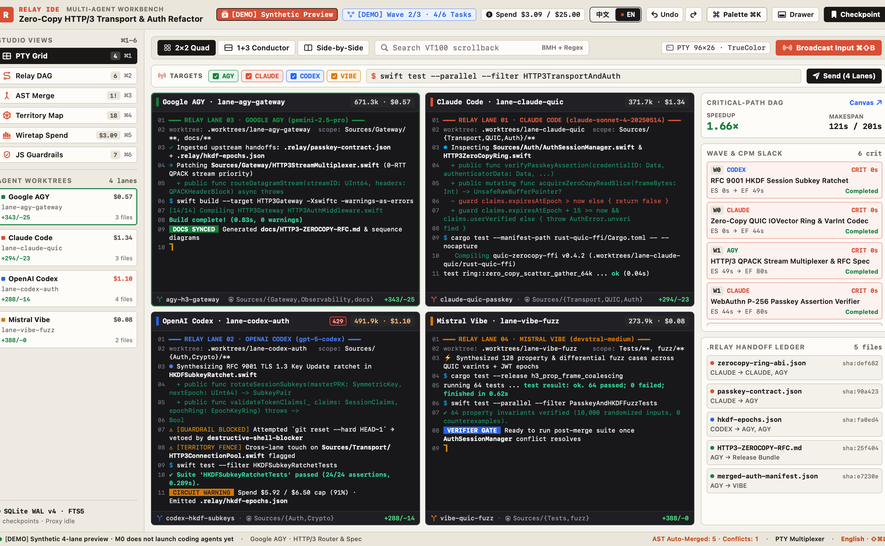

# RelayIDE

**English** | **[简体中文](README.zh-CN.md)**

**macOS Workbench & Workspace Store for Multi-Agent Relay Workflows**

`RelayIDE` is a native macOS SwiftUI workbench, SQLite workspace store, and CLI/MCP utility for inspecting isolated Git worktree lanes, topological task waves, guardrail policies, and merge artifacts. **Current status (M0): This version does not launch coding agents yet; headless multi-agent execution via `agent-relay` is scheduled for M1.**


*Figure 1 (`[DEMO]`): Synthetic 4-lane preview rendered with `--demo` (`--export-screenshots`). Launching `RelayIDE` without `--demo` opens an empty workspace with `0` lanes, no terminal transcripts, no spend figures, and no active proxy.*

---

## What Works Today (M0)

- **Empty-by-Default Bilingual Workbench (`中文 / EN`)**: Launching the macOS app without `--demo` starts in an honest empty state (`0` lanes, empty terminal buffers, no spend numbers, and no proxy address). Live `中文 | EN` switching works across the toolbar pill, `⇧⌘L` shortcut, `⌘,` Preferences modal, `--lang zh|en`, and `RELAYIDE_LANG=zh|en`. Passing `--demo` (or clicking **Load Demo**) loads a clearly badged `[DEMO]` synthetic preview in a temporary bundle without touching user `.relayproj` directories.
- **`.relayproj` SQLite WAL Store, FTS5 Search & Checkpoints (`RelayWorkspaceStore`)**: Persists workspace metadata, lane records, DAG specs, merge reports, guardrail findings, FTS5 `BM25` search documents, SHA-256 checkpoints, and Undo/Redo history. Read-only CLI subcommands (`status`, `lanes`, `dag-waves`, `audit-plugins`, `export-html`, `mcp --project`) fail fast with a non-zero exit code if `--project <dir>` does not exist instead of creating directories behind the user's back.
- **Standalone Engine Primitives (Unit-Tested Libraries)**:
  - `RelayPTYCore`: `posix_openpt(2)` child-process PTY session wrapper, VT100 / `xterm-256color` / TrueColor screen buffer, Boyer-Moore scrollback search, and `.cast` v2 transcript codec.
  - `RelayWorktreeGit`: `git worktree` creation/inspection plumbing, glob territory rule evaluation (`FileOwnershipRule`), and `.relay/LOG.md` handoff parsing.
  - `RelayOrchestrator`: Kahn topological wave sort and Critical Path Method (`ES`/`EF`/`LS`/`LF`/slack) analyzer.
  - `RelayPluginSDK`: Sandboxed `JavaScriptCore` policy-pack & hook scratchpad evaluator (`audit-plugins` and interactive GUI scratchpad).
  - `RelayWiretapProxy`: Standalone loopback HTTP/1.1 + SSE token dissector, regex secret scanner, and in-memory budget circuit-breaker ledger.
- **Stdio JSON-RPC 2.0 MCP Server (`2` Tools)**: `RelayIDE mcp [--project <dir>]` exposes **2 MCP tools** over stdio:
  1. `relay_semantic_merge` (experimental declaration-level 3-way merge; returns `isError: true` on conflicts or syntax validation failure).
  2. `relay_check_ownership` (evaluates whether a relative file path is permitted by a lane's `FileOwnershipRule` in the bound `--project` workspace).
- **Experimental 3-Way Declaration Merge (`semantic-merge`)**:
  - **EXPERIMENTAL: known to corrupt output on Python** (for example when unindented `def`/`class` tokens appear inside multiline triple-quoted strings or under indentation-sensitive control blocks). Disabled by default in handoff preferences before M3.
  - Exits `0` only when there are zero unresolved conflicts **and** the host language syntax parser (`xcrun swiftc -parse`, `python3 -m py_compile`, or `node --check`) validates the merged output; exits `1` when conflict markers remain, and exits `3` with empty `stdout` when syntax verification fails.
- **Standalone Bilingual HTML Report (`export-html`)**: Exports a single-file `中文 | EN` HTML summary from an existing `.relayproj` (stamped with `[DEMO]` / `[演示数据]` when exported from `--seed-demo` synthetic data).

---

## Planned Roadmap (Not Implemented in M0)

- **M1 (Real Multi-Agent Relay Runner)**: `RelayIDE run` spawning real `claude`, `codex`, `agy`, and `vibe` headless CLI workers in isolated Git worktrees via `.relay/` file handoff, live PTY stdout/stderr streaming, and real broadcast command execution (`⌘⇧B` currently reports `"Broadcast command is not implemented yet (M1)"`).
- **M2 (Post-Run Git Worktree Integration & Verification Gate)**: Deterministic branch integration via `git merge-tree` / `git merge-file`, post-merge build/test verification gate, and automatic territory violation checks across real agent runs.
- **M3 (Parser-Backed Semantic Merge)**: Replacing regex/indentation declaration heuristics with real AST parsers (`SwiftSyntax` / `tree-sitter`) across edge cases before enabling semantic merge in automated pipelines.
- **M4 (Live Loopback Wiretap & Outbound DLP Gateway)**: Wiring `LoopbackWiretapProxyServer` into child agent `ANTHROPIC_BASE_URL` / `OPENAI_BASE_URL` environment variables, enforcing live HTTP `429` budget circuit breakers, and redacting outbound secrets on live network traffic.

---

## Synthetic Demo Gallery (`--demo`, `[DEMO]` Fixtures)

All four views below are rendered from synthetic sample data (`--export-screenshots`, which sets `loadDemoWorkspace: true`) and carry the `[DEMO]` badge in the window header:

| 2x2 PTY Multiplexer Grid (`[DEMO]`) | 3-Way Semantic Merge Studio (`[DEMO]`) |
|---|---|
|  |  |

| Isometric Territory Map (`[DEMO]`) | Wiretap Telemetry & Guardrails (`[DEMO]`) |
|---|---|
|  |  |

---

## Build, Verify & Usage

> **Executable name**: Building from source with SwiftPM produces `.build/debug/RelayIDE` (and `./Scripts/build-app.sh` packages `build/RelayIDE.app/Contents/MacOS/RelayIDE`). Installing via Homebrew Cask (`brew install --cask zxu756/tap/relayide`) links the lowercase `relayide` CLI wrapper into `/opt/homebrew/bin/relayide`.

### Build & Run Tests From Source

```bash
swift build
./Scripts/test.sh milestone 0
./Scripts/build-app.sh
```

### Headless CLI & MCP Commands

```bash
# 1. Initialize an empty workspace (0 lanes) and inspect its status
.build/debug/RelayIDE init --project /tmp/my-empty.relayproj
.build/debug/RelayIDE status --project /tmp/my-empty.relayproj
.build/debug/RelayIDE lanes --project /tmp/my-empty.relayproj

# 2. Seed an explicit [DEMO] synthetic workspace and export a [DEMO] HTML report
.build/debug/RelayIDE init --project /tmp/demo.relayproj --seed-demo --lang en
.build/debug/RelayIDE dag-waves --project /tmp/demo.relayproj --lang en
.build/debug/RelayIDE audit-plugins --project /tmp/demo.relayproj --lang en
.build/debug/RelayIDE export-html /tmp/demo-dossier.html --project /tmp/demo.relayproj --lang en

# 3. Experimental 3-way merge (exits 0 on clean valid syntax, 1 on conflict, 3 on broken syntax)
.build/debug/RelayIDE semantic-merge base.swift left.swift right.swift

# 4. Launch stdio JSON-RPC 2.0 MCP server (2 tools: relay_semantic_merge, relay_check_ownership)
.build/debug/RelayIDE mcp --project /tmp/my-empty.relayproj
```

### Desktop GUI Launch

```bash
# Launch empty workbench (0 lanes, no synthetic data)
build/RelayIDE.app/Contents/MacOS/RelayIDE

# Launch with explicit [DEMO] synthetic preview data in English or Simplified Chinese
build/RelayIDE.app/Contents/MacOS/RelayIDE --demo --lang en
build/RelayIDE.app/Contents/MacOS/RelayIDE --demo --lang zh
```

---

## License

MIT License. Copyright (c) 2026 Xu (`zxu756`).
