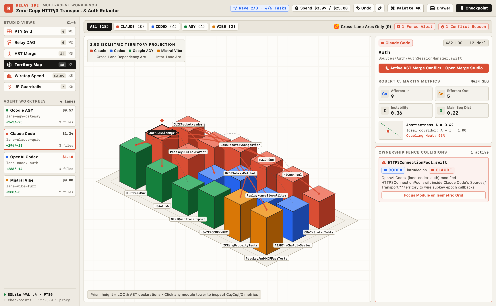
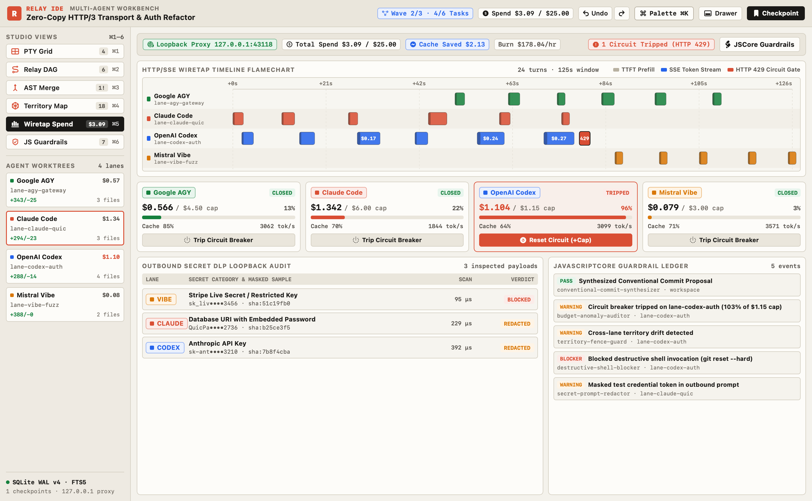

# RelayIDE `v1.1.0`

**English** | **[简体中文](README.zh-CN.md)**

**Multi-Vendor Coding Agent Parallel Workbench, 3-Way Semantic AST Merger & Wiretap Budget Proxy for macOS**


`RelayIDE v1.1.0` (pure Swift 6 across 11 isolated SwiftPM library modules + native macOS desktop executable + automated `@Test` verification suite) is a native macOS workbench for orchestrating multiple AI coding agents (`Claude Code`, `OpenAI Codex`, `Google Antigravity / agy`, and `Mistral Vibe`) concurrently across isolated Git worktrees without stepping on each other's files, blowing API budgets, or drowning in false line-level Git merge conflicts.

---

## Highlights (`v1.1.0`)

- **Live In-App `中文 / EN` Bilingual Workbench (`v1.1.0`)**: Instant zero-restart `中文 | EN` switching across every studio surface via the Bauhaus Warm Sandpaper (`#F4F2EC` / `#18181B` / `#C2410C`) toolbar segmented pill, `⇧⌘L` menu shortcut, `⌘,` Preferences selector, `--lang zh|en` / `RELAYIDE_LANG` CLI override, automatic macOS Chinese locale detection, and interactive bilingual HTML audit dossiers.
- **4-Vendor POSIX PTY Multiplexer (`RelayPTYCore`, `5,836 LOC`)**: Direct `posix_openpt(2)` + `TIOCSWINSZ` pseudo-terminal supervisor paired with a handwritten VT100 / `xterm-256color` / 24-bit TrueColor terminal emulator, WCAG AA/AAA contrast clamping, Boyer-Moore scrollback search, Asciinema v2 `.cast` export, binary split-tree multiplexer (`2×2 Quad`, `1+3 Conductor`, `Side-by-Side`), and 60 Hz frame coalescing.
- **3-Way Declaration-Level Semantic AST Merger (`RelaySemanticMerge`, `7,983 LOC`)**: Handwritten multi-language (`Swift`, `Python`, `TypeScript`, `Rust`, `Go`) declaration parser and 3-way semantic AST merger that auto-merges disjoint function/method/import edits where classic line-based `diff3` emits bogus conflicts, backed by Myers $O(ND)$ + Patience Diff, cross-file broken call-site arity detection, and Robert C. Martin `(Ca, Ce, I, A, D)` coupling analysis.
- **Git Worktree Plumbing & Live Territory Guardrails (`RelayWorktreeGit`, `4,208 LOC`)**: Isolated per-lane Git worktrees, pure-Swift RFC 1950 zlib loose object inspector, `CoreServices` `FSEvents` real-time territory ownership enforcement with optional auto-revert, `.relay/LOG.md` SHA-256 handoff contracts, and worker recursion blocking.
- **Loopback HTTP/SSE Wiretap & Per-Lane USD Circuit Breakers (`RelayWiretapProxy`, `4,413 LOC`)**: Local `127.0.0.1` HTTP/1.1 + SSE stream dissector for Anthropic Messages, OpenAI Responses, Google Gemini, and Mistral Chat streams, structure-preserving outbound secret DLP redaction, EWMA burn-rate forecasting, and automatic HTTP `429` budget circuit breakers.
- **SQLite WAL Persistence, FTS5 Search & `JavaScriptCore` Guardrail SDK**: `.relayproj` SQLite WAL (`v1..v4` migrations), VT100-stripped FTS5 `BM25` full-text search, persistent Undo/Redo & SHA-256 workspace checkpoints, and a capability-gated `JavaScriptCore` guardrail host with built-in lifecycle plugins and microsecond latency profiling.

---

## Architecture (11 SwiftPM Modules + Desktop App)

| Module | LOC | Responsibility |
|---|---:|---|
| `RelayModels` | `1,640` | Multi-vendor roster, live `RelayLocalizer` (`zh-Hans` / `en`), VT100/TrueColor cell models, Git worktree/ownership globs, declaration AST & 3-Way Semantic Merge types, DAG & Wiretap models |
| `RelayPTYCore` | `5,836` | POSIX `posix_openpt` process multiplexer, handwritten VT100 / `xterm-256color` / TrueColor emulator, Boyer-Moore search, `.cast` v2 codec, binary split tree |
| `RelayWorktreeGit` | `4,208` | Git worktree lifecycle, RFC 1950 zlib loose object reader, `FSEvents` territory fence monitor, intraline diff parser, `.relay` SHA-256 handoff codec |
| `RelaySemanticMerge` | `7,983` | 5-language (`Swift`/`Python`/`TS`/`Rust`/`Go`) declaration AST parser, **3-Way Semantic AST Merger**, Myers/Patience Diff3, broken call-site detector, Martin coupling |
| `RelayWorkspaceStore` | `2,939` | `.relayproj` SQLite3 WAL (`v1..v4`), FTS5 `BM25` search store, crash-safe checkpoint journal, persistent infinite Undo/Redo |
| `RelayWiretapProxy` | `4,413` | `127.0.0.1` HTTP/1.1 + 4-vendor SSE token dissector, outbound secret DLP engine, EWMA spend analytics, per-lane USD circuit breakers |
| `RelayPluginSDK` | `1,833` | Sandboxed `JavaScriptCore` guardrail host, p50/p95/p99 microsecond profiler, built-in lifecycle plugins, `.relay-guardrails.json` policy pack codec |
| `RelayOrchestrator` | `2,700` | Kahn topological DAG wave scheduler, Critical Path Method (`ES`/`EF`/`LS`/`LF`/slack) analyzer, quota failover controller, demo campaign synthesizer |
| `RelayCLIAndMCP` | `710` | Headless `RelayIDE` `v1.1.0` CLI (`init`, `status`, `lanes`, `dag-waves`, `semantic-merge`, `audit-plugins`, `export-html`, `mcp`), JSON-RPC 2.0 MCP server, bilingual Hallmark HTML dossier |
| `RelayWorkbenchShell` | `2,420` | Bauhaus Warm Sandpaper (`#F4F2EC`) + Carbon Matte (`#18181B`) shell tokens, bilingual `⌘K` fuzzy subsequence palette, two-stroke chord keybinding collision registry |
| `RelayStudioViews` + `RelayIDE` | `7,540` | Bilingual 2×2 Live PTY Grid, Critical-Path DAG Canvas, 3-Pane Semantic AST Merge Studio, 2.5D Isometric Territory Map, Wiretap Flamechart & Guardrail Studio |
| `RelayIDETests` | `5,840` | `129` automated Swift Testing (`@Test`) verification checks across 7 end-to-end suites |

---

## Gallery (2x Retina `2720 × 1680`)

| 2×2 Multi-Vendor PTY Multiplexer Grid | 3-Way Semantic AST Merge Studio |
|---|---|
|  |  |

| 2.5D Isometric Coupling & Territory Map | Wiretap Token Flamechart & Guardrail Plugins |
|---|---|
|  |  |

---

## Install & Usage

### Homebrew Cask

```bash
brew install --cask zxu756/tap/relayide
```

### Build & Verify From Source

```bash
git clone https://github.com/zxu756/RelayIDE.git
cd RelayIDE
swift test --no-parallel
./Scripts/build-app.sh
open build/RelayIDE.app
```

### Headless CLI, Bilingual Screenshots & MCP Server

```bash
# Seed a reproducible 4-vendor workspace bundle & export a bilingual HTML audit dossier
relayide init --project ./demo.relayproj --seed-demo
relayide dag-waves --project ./demo.relayproj
relayide semantic-merge base.swift left.swift right.swift
relayide export-html ./relay-dossier.html --project ./demo.relayproj

# Export 2x Retina (2720 × 1680) workbench screenshots in English or Simplified Chinese
relayide --export-screenshots ./docs --lang en
relayide --export-screenshots ./docs --lang zh

# Launch stdio JSON-RPC 2.0 MCP server (relay_semantic_merge, relay_check_ownership)
relayide mcp
```

---

## License

MIT License. Copyright (c) 2026 Xu (`zxu756`).
