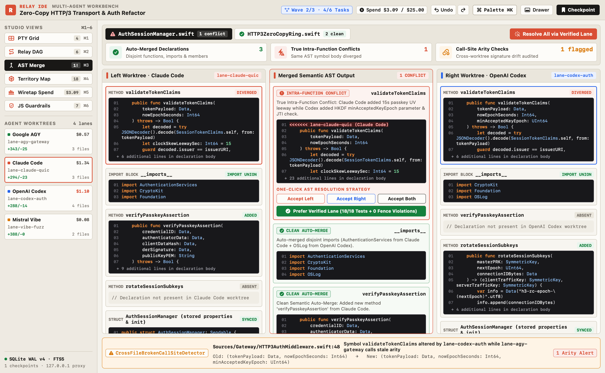

# RelayIDE

**English** | **[简体中文](README.zh-CN.md)**

**macOS Workbench & Workspace Store for Multi-Agent Relay Workflows**

`RelayIDE` is a native macOS CLI, SQLite workspace store, MCP utility, and SwiftUI workbench built on top of `agent-relay` (`relay.sh`; you must install `agent-relay` first). **Current status (M1): `RelayIDE run` launches headless coding agents (`claude`, `codex`, `agy`, `vibe`) in isolated Git worktrees via `agent-relay` and commits succeeded or partial lanes to their own branches; this version does not merge branches, does not execute `verify` commands, has no whole-job budget (`RELAY_BUDGET_USD`), and does not connect the desktop UI to live runs yet.**


*Figure 1 (`[DEMO]`): Synthetic 4-lane preview rendered with `--demo` (`--export-screenshots`). Launching `RelayIDE` without `--demo` opens an empty workspace with `0` lanes, no terminal transcripts, no spend figures, and no active proxy.*

---

## What Works Today (M1)

- **Headless Multi-Agent Worktree Runner (`run`, `status --run`, `status --runs`)**: `RelayIDE run <plan.json> --project <dir> [--relay-sh <path>] [--lang zh|en]` executes a multi-lane plan on a real Git repository through `agent-relay` (`relay.sh`, resolved from `--relay-sh`, `RELAYIDE_RELAY_SH`, or `~/.agents/skills/agent-relay/scripts/relay.sh` alongside `relay_util.py`).
  - **Validation & locking.** Validates `plan.json` before touching disk (agents `claude`, `codex`, `agy`, `vibe`; lane IDs matching `^[a-z0-9][a-z0-9-]{0,39}$` with `integration` reserved for M2; at most one predecessor per lane in M1; acyclicity; configured repository Git `user.name` and `user.email`; `--project` existing outside the repository working tree; `RELAY_BUDGET_USD` unset; `RELAY_WORKER` unset) and acquires a non-blocking `flock` on `<project>/run.lock`.
  - **Execution, transcripts & commits.** Serially creates isolated worktrees at `<project>/runs/<run-id>/worktrees/<lane>` on new branches `relay/<run-id>/<lane>` (`git worktree add -b`, never resetting existing branches), runs `<relay.sh> <agent> <worktree> <prompt>` inside a POSIX PTY, and appends PTY master output to `<project>/runs/<run-id>/lanes/<lane>.pty` (this `.pty` file is the PTY terminal transcript with `\r\n` line discipline, not byte-for-byte raw agent output; raw CLI output is written by `relay.sh` to `<worktree>/.relay/NN-<agent>.log`). Independent lanes start immediately; a dependent lane starts from its predecessor's committed branch head as soon as the predecessor finishes `succeeded` or `succeeded-no-changes`, and is marked `skipped` without creating a worktree or branch otherwise. `succeeded` and `partial` lanes commit their changes (`git commit --no-verify`, excluding `.relay/`) using the repository's configured Git identity; failed, timed-out, refused, cancelled, or killed lanes are not committed and record their uncommitted file list.
  - **Spend, signals & exit codes.** Parses USD spend (`costSource: "usd"`), unpriced token counts (`costUSD: null`, `costSource: "unpriced"`), or missing records (`costSource: "no_record"`) from `<worktree>/.relay/LOG.md`. Handles `SIGINT` (`130`) and `SIGTERM` (`143`) via a `SIGINT -> SIGTERM -> descendant process-group SIGKILL` escalation ladder without committing cancelled lanes, and reconciles runs orphaned by `kill -9` to `interrupted` when `run.lock` is no longer held. Exit codes of `run`: `0` all lanes succeeded; `1` completed with at least one non-succeeded lane; `2` plan/usage/identity validation error (empty stdout); `125` environment/lock/internal error (empty stdout); `130` / `143` cancelled by `SIGINT` / `SIGTERM`. Prints the run JSON ledger on stdout, byte-identical to `RelayIDE status --project <dir> --run <run-id>`.
  - **Current M1 boundaries.** Does not merge lane branches into an integration branch (M2); records `verify` in SQLite and notes on stderr that `verify` executes in M2; rejects `RELAY_BUDGET_USD` (exit `2`) because per-worktree `LOG.md` files do not accumulate whole-job spend across lanes (M4); unknown non-flag non-`.relayproj` first arguments exit `2` on stderr instead of opening the desktop window.
- **Empty-by-Default Bilingual Workbench (`中文 / EN`)**: Launching the macOS app without `--demo` starts in an honest empty state (`0` lanes, empty terminal buffers, no spend numbers, and no proxy address). Live `中文 | EN` switching works across the toolbar pill, `⇧⌘L` shortcut, `⌘,` Preferences modal, `--lang zh|en`, and `RELAYIDE_LANG=zh|en`. Passing `--demo` (or clicking **Load Demo**) loads a clearly badged `[DEMO]` synthetic preview in a temporary bundle without touching user `.relayproj` directories.
- **`.relayproj` SQLite WAL Store, Run Ledger, FTS5 Search & Checkpoints (`RelayWorkspaceStore`)**: Schema v5 (with `busy_timeout`) persists M1 run and lane ledgers (`relay_runs`, `relay_run_lanes`, queried via `status --run <id>` and `status --runs`) alongside workspace metadata, lane records, DAG specs, merge reports, guardrail findings, FTS5 `BM25` search documents, SHA-256 checkpoints, and Undo/Redo history. Read-only CLI subcommands (`status`, `lanes`, `dag-waves`, `audit-plugins`, `export-html`, `mcp --project`) fail fast with a non-zero exit code if `--project <dir>` does not exist instead of creating directories behind the user's back. On a workspace made with `init`, plain `status` reports `activeLaneCount: 0`, `status --runs` prints `[]`, `lanes` prints nothing, and `dag-waves` prints `No DAG registered`; `init --seed-demo` populates the M0 preview tables with synthetic `[DEMO]` rows.
- **Standalone Engine Primitives (Unit-Tested Libraries)**:
  - `RelayPTYCore`: `posix_openpt(2)` child-process PTY session wrapper, `<sys/wait.h>` exit/signal decoder (`POSIXWaitStatus`), descendant process-tree enumeration (`proc_listchildpids`), VT100 / `xterm-256color` / TrueColor screen buffer, Boyer-Moore scrollback search, and `.cast` v2 transcript codec.
  - `RelayWorktreeGit`: `git worktree add -b` creation, lane change staging/committing (`--no-verify`, excluding `.relay/`), glob territory rule evaluation (`FileOwnershipRule`), and `.relay/LOG.md` handoff parsing.
  - `RelayOrchestrator`: Event-driven single-predecessor lane scheduler (`RelayDAGRunScheduler`), `.relay/LOG.md` spend/token parser, Kahn topological wave sort, and Critical Path Method (`ES`/`EF`/`LS`/`LF`/slack) analyzer.
  - `RelayPluginSDK`: Sandboxed `JavaScriptCore` policy-pack & hook scratchpad evaluator (`audit-plugins` and interactive GUI scratchpad).
  - `RelayWiretapProxy`: Standalone loopback HTTP/1.1 + SSE token dissector, regex secret scanner, and in-memory budget circuit-breaker ledger.
- **Stdio JSON-RPC 2.0 MCP Server (`2` Tools)**: `RelayIDE mcp [--project <dir>]` exposes **2 MCP tools** over stdio:
  1. `relay_semantic_merge` (the same guarded 3-way merge as the `semantic-merge` subcommand described below; `isError` is `false` only where the subcommand would exit `0`).
  2. `relay_check_ownership` (evaluates whether a relative file path is permitted by a lane's `FileOwnershipRule` in the bound `--project` workspace).
- **Guarded 3-Way Merge (`semantic-merge`, experimental)**: `RelayIDE semantic-merge <base> <left> <right>` is anchored on `git merge-file` and needs `git` on `PATH`. Disabled by default in handoff preferences before M3.
  - **What it does.** It first runs the line-level merge `git merge-file -p`. If git merges cleanly, the output is git's text, byte for byte. If git reports conflicts, the output is git's conflict-marked text, with one exception: when every conflict block is a plain "both sides inserted lines at the same place" block, the file type has a syntax checker, and the declaration-level engine, asked as a referee, produces the same non-blank lines in the same order, both insertions are kept (one side's lines, then the other's, in the order the engine chose). The printed text is always assembled from git's own output. The engine's text is never printed.
  - **What exit `0` guarantees.** Every line either side added is in the output. Every line neither side touched is byte-identical, blank lines and string contents included. For `.py`/`.pyi`, `.swift`, `.js`/`.mjs`/`.cjs`, `.ts`/`.tsx` and `.json` the output passed that language's parser (`python3 -m py_compile`, `xcrun swiftc -parse`, `node --check`, `tsc --noEmit` or, without `tsc`, Node type stripping plus `node --check`, `JSONSerialization`).
  - **What it does not guarantee.** A merge that parses can still be wrong in meaning, exactly as with `git merge`. When both insertions are kept, which one comes first is the engine's choice and is only checked by the parser. The declaration-level engine on its own is known to corrupt Python and Swift (it drops decorators and attributes and re-spaces declarations), which is why it only gets a veto and why most conflicts stay conflicts. Whether the engine is kept at all is decided in M3.
  - **Other file types.** For every other extension (`.rs`, `.go`, `.java`, `.jsx`, no extension, ...) there is no syntax checker. The command then behaves exactly like `git merge-file`: a clean result with exit `0` and a note on stderr that it was not syntax-checked, or git's conflict text with exit `1`. The declaration-level engine is not consulted.
  - **Exit codes.** `0` clean. `1` conflict; stdout is git's conflict-marked text. `2` usage error, unreadable file or input that is not UTF-8. `3` git merged cleanly but the result does not parse; nothing is printed. `4` git is missing or `git merge-file` failed; nothing is merged. One stderr line says which result was used: `[strategy=line-level]`, `[strategy=declaration-level]` or `[strategy=none]`.
  - **Measured on `Fixtures/merge-cases`** (35 three-way cases in Swift, Python, TypeScript, JavaScript, Rust, Go and Java; checked on 2026-11-14 by `Scripts/acceptance/merge_cases_check.py`, which compares every result with `git merge-file`; output in `reports/m0-acceptance.txt`): 15 clean results identical to git, 8 conflicts resolved by keeping both insertions, 12 conflicts reported with git's own text, 0 cases worse than `git merge-file`.
- **Standalone Bilingual HTML Report (`export-html`)**: Exports a single-file `中文 | EN` HTML summary from an existing `.relayproj` (stamped with `[DEMO]` / `[演示数据]` when exported from `--seed-demo` synthetic data).

---

## Planned Roadmap (Not Implemented Yet)

- **M2 (Branch Merge Pipeline & `verify` Gate)**: Merging completed lane branches onto `relay/<run-id>/integration` via `git merge --no-ff`, aborting cleanly on conflicts, and streaming `verify` command output with process-group timeout cleanup.
- **M3 (Semantic Merge Evaluation)**: Corpus evaluation against real open-source merge commits (`git merge-file` vs current engine vs `mergiraf`) to decide whether semantic merge is replaced with `SwiftSyntax` / `tree-sitter` or removed.
- **M4 (Spend & Whole-Job Budget)**: Cross-lane whole-job budget enforcement and deciding whether to keep or remove the standalone loopback proxy.
- **M5 (Desktop UI Connected to Live Runs)**: Wiring the SwiftUI terminal grid, lane status/spend list, file ownership view, and merge studio to live M1/M2 runs, plus real broadcast command execution (`⌘⇧B` currently reports `"Broadcast command is not implemented yet (M5)"`).

---

## Known Issues

- **`semantic-merge` and TypeScript without `tsc`.** When `tsc` is not on `PATH`, TypeScript is checked with Node's built-in type stripping, which rejects syntax that cannot simply be erased (`enum`, `namespace`, constructor parameter properties) and JSX in `.tsx`. A merge of such a file exits `3` even when the merge itself is fine.
- **`semantic-merge` resolves few conflicts.** It only ever keeps both sides of "both inserted at the same place" conflicts, and only when the declaration-level engine reproduces every non-blank line. Renames, edits to adjacent lines and anything the engine misreads stay conflicts, as with `git merge-file`.
- **Verification gate hangs on large output (library only).** `VerificationCommandGateEvaluator.runGateCommand` reads the child's stdout and stderr only after the child has exited. A command that prints more than the pipe buffer (about 64 KB) blocks, runs into the timeout and is reported as exit `124` instead of its real status. `RelayIDE run` does not execute `verify` in M1; this must be fixed before M2 uses it.
- **Verification gate timeout kills one process only (library only).** On timeout the same function terminates the shell it started, not the shell's process group, so child processes of the verification command keep running.
- **Legacy workspace inspection tables vs M1 run ledger.** `RelayIDE run` writes runs and lanes into the v5 `relay_runs` and `relay_run_lanes` tables queried via `status --run <id>` and `status --runs`. The older `lanes`, `dag-waves`, `audit-plugins`, and `export-html` commands and the desktop UI still read the M0 workspace tables (only populated by `init --seed-demo`) until M5 connects the UI to live runs.

---

## Synthetic Demo Gallery (`--demo`, `[DEMO]` Fixtures)

All four views below are rendered from synthetic sample data (`--export-screenshots`, which sets `loadDemoWorkspace: true`) and carry the `[DEMO]` badge in the window header:

| 2x2 PTY Multiplexer Grid (`[DEMO]`) | 3-Way Semantic Merge Studio (`[DEMO]`) |
|---|---|
|  |  |

| Isometric Territory Map (`[DEMO]`) | Wiretap Telemetry & Guardrails (`[DEMO]`) |
|---|---|
|  |  |

---

## Build, Verify & Usage

> **Executable name & prerequisite**: Building from source with SwiftPM produces `.build/debug/RelayIDE` (and `./Scripts/build-app.sh` packages `build/RelayIDE.app/Contents/MacOS/RelayIDE`). Installing via Homebrew Cask (`brew install --cask zxu756/tap/relayide`) links the lowercase `relayide` CLI wrapper into `/opt/homebrew/bin/relayide`. Running `RelayIDE run` requires `agent-relay` installed at `~/.agents/skills/agent-relay/scripts/relay.sh` (or passed via `--relay-sh` / `RELAYIDE_RELAY_SH`).

### Build & Run Tests From Source

```bash
swift build
./Scripts/test.sh milestone 0
./Scripts/test.sh milestone 1
./Scripts/build-app.sh
```

### `plan.json` Format for `RelayIDE run`

Invoke `.build/debug/RelayIDE run <plan.json> --project <dir.relayproj> [--relay-sh <path>] [--lang zh|en]` against an existing `.relayproj` outside the target Git repository (with `user.name` and `user.email` configured in that repository):

```json
{
  "repo": "../target-repo",
  "base": "main",
  "lanes": [
    {"id": "api",  "agent": "claude", "prompt": "prompts/api.md",  "after": []},
    {"id": "docs", "agent": "agy",    "prompt": "prompts/docs.md", "after": ["api"]}
  ],
  "verify": "swift build && swift test"
}
```

### Headless CLI & MCP Commands

Run these from the repository root after `swift build`. They are exactly the commands `Scripts/acceptance/readme-commands.sh` extracts from this file and executes.

```bash
# 0. Scratch directory for the examples below
WORK="$(mktemp -d)"

# 1. Inspect CLI help, initialize an empty workspace (0 lanes), and inspect its status and run ledger
.build/debug/RelayIDE --help --lang en
.build/debug/RelayIDE version --lang en
.build/debug/RelayIDE init --project "$WORK/my-empty.relayproj" --lang en
.build/debug/RelayIDE status --project "$WORK/my-empty.relayproj" --lang en
.build/debug/RelayIDE status --project "$WORK/my-empty.relayproj" --runs --lang en
.build/debug/RelayIDE lanes --project "$WORK/my-empty.relayproj" --lang en

# 2. Seed an explicit [DEMO] synthetic workspace and export a [DEMO] HTML report
.build/debug/RelayIDE init --project "$WORK/demo.relayproj" --seed-demo --lang en
.build/debug/RelayIDE dag-waves --project "$WORK/demo.relayproj" --lang en
.build/debug/RelayIDE audit-plugins --project "$WORK/demo.relayproj" --lang en
.build/debug/RelayIDE export-html "$WORK/demo-dossier.html" --project "$WORK/demo.relayproj" --lang en

# 3. Guarded 3-way merge: git merges this one cleanly, so the output is git's text (exit 0)
.build/debug/RelayIDE semantic-merge \
  Fixtures/merge-cases/20-py-decorator-added/base.py \
  Fixtures/merge-cases/20-py-decorator-added/left.py \
  Fixtures/merge-cases/20-py-decorator-added/right.py --lang en

#    Both sides add a method at the same place: git reports a conflict, both insertions are kept (exit 0)
.build/debug/RelayIDE semantic-merge \
  Fixtures/merge-cases/02-swift-both-add-func/base.swift \
  Fixtures/merge-cases/02-swift-both-add-func/left.swift \
  Fixtures/merge-cases/02-swift-both-add-func/right.swift --lang en

#    A real conflict: stdout is git's conflict-marked text and the exit code is 1
.build/debug/RelayIDE semantic-merge \
  Fixtures/merge-cases/12-swift-true-conflict/base.swift \
  Fixtures/merge-cases/12-swift-true-conflict/left.swift \
  Fixtures/merge-cases/12-swift-true-conflict/right.swift --lang en || echo "semantic-merge exit code: $?"

# 4. stdio JSON-RPC 2.0 MCP server (2 tools: relay_semantic_merge, relay_check_ownership): list the tools
printf '%s\n' '{"jsonrpc":"2.0","id":1,"method":"initialize","params":{}}' '{"jsonrpc":"2.0","id":2,"method":"tools/list","params":{}}' | .build/debug/RelayIDE mcp --project "$WORK/my-empty.relayproj" --lang en
```

### Desktop GUI Launch

```bash
# Launch empty workbench (0 lanes, no synthetic data)
build/RelayIDE.app/Contents/MacOS/RelayIDE

# Launch with explicit [DEMO] synthetic preview data in English or Simplified Chinese
build/RelayIDE.app/Contents/MacOS/RelayIDE --demo --lang en
build/RelayIDE.app/Contents/MacOS/RelayIDE --demo --lang zh
```

---

## License

MIT License. Copyright (c) 2026 Xu (`zxu756`).
