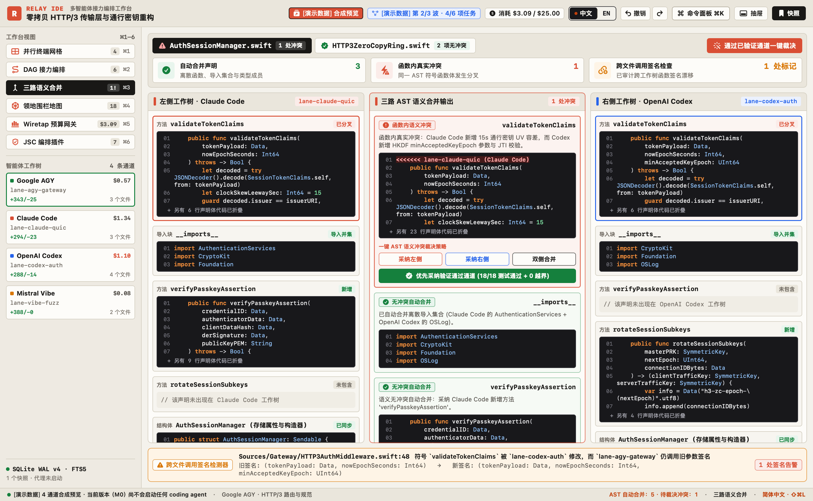
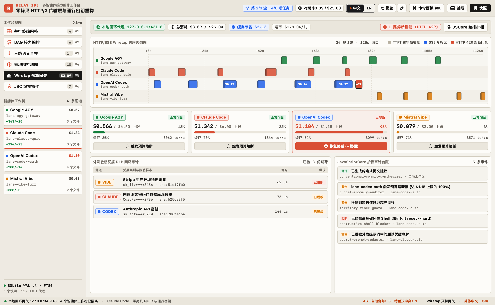

# RelayIDE

**[English](README.md)** | **简体中文**

**面向 macOS 的多智能体接力工作台与工作区存储工具**

`RelayIDE` 是一款原生 macOS SwiftUI 桌面工作台、SQLite 工作区存储库以及 CLI/MCP 命令行工具，用于查看隔离 Git 工作树通道、拓扑任务波次、护栏策略与合并产物。**当前状态（M0）：当前版本尚不会启动任何 coding agent；基于 `agent-relay` 的无界面多智能体真实调度排在 M1。**


*图 1（`[演示数据]`）：传入 `--demo`（`--export-screenshots`）渲染的四通道合成预览界面。不带 `--demo` 启动 `RelayIDE` 时默认进入空状态：0 条泳道、无终端假输出、无费用数字、无代理地址。*

---

## 当前可用能力（M0）

- **默认空启动的 `中文 / EN` 双语桌面工作台**：不带 `--demo` 启动 macOS 桌面端时，界面保持真实空状态（`0` 条通道、空终端缓冲区、无预算金额、无回环代理地址）。支持通过顶部工具栏 `中文 | EN` 胶囊、菜单快捷键 `⇧⌘L`、`⌘,` 偏好设置弹窗、CLI `--lang zh|en` 或环境变量 `RELAYIDE_LANG=zh|en` 实时切换中英文。仅在显式传入 `--demo`（或点击界面中的「载入演示数据」）时才会在临时目录载入带 `[演示数据]` 徽章的合成样本，绝不污染用户的 `.relayproj` 目录。
- **`.relayproj` SQLite WAL 存储、FTS5 检索与检查点（`RelayWorkspaceStore`）**：持久化保存工作区元数据、通道定义、DAG 拓扑描述、合并报告、护栏审计记录、FTS5 `BM25` 全文检索索引、SHA-256 快照以及 Undo/Redo 历史。所有只读/查询类 CLI 子命令（`status`、`lanes`、`dag-waves`、`audit-plugins`、`export-html`、`mcp --project`）在 `--project <dir>` 不存在时均立即报错并以非 0 状态码退出，不会在后台偷偷创建空目录或数据库。**这些子命令只做只读检视：这一版没有任何命令能创建通道或 DAG。** 对 `init` 建出来的工作区，`lanes` 没有输出，`dag-waves` 输出“当前工作区尚未注册任何 DAG”；只有 `init --seed-demo` 会往里写内容，写的是带 `[演示数据]` 标记的合成数据。
- **独立基础库组件（已通过单元测试验证）**：
  - `RelayPTYCore`：基于 `posix_openpt(2)` 的本地子进程伪终端会话封装、VT100 / `xterm-256color` / 24 位真彩色屏幕缓冲区、Boyer-Moore 历史检索与 `.cast` v2 编解码。
  - `RelayWorktreeGit`：`git worktree` 创建与工作树差异检查、基于 glob 的文件领地规则匹配（`FileOwnershipRule`）以及 `.relay/LOG.md` 交接日志解析。
  - `RelayOrchestrator`：Kahn 拓扑波次排序与关键路径法（`ES`/`EF`/`LS`/`LF`/松弛时间）计算器。
  - `RelayPluginSDK`：沙箱化 `JavaScriptCore` 策略包与钩子演练台求值器（支持 `audit-plugins` 与 GUI 交互演练）。
  - `RelayWiretapProxy`：独立本地回环 HTTP/1.1 + SSE 流解析器、敏感凭据正则扫描器与内存预算熔断账本。
- **基于 stdio 的 JSON-RPC 2.0 MCP 服务器（共 `2` 个工具）**：`RelayIDE mcp [--project <dir>]` 通过标准输入/输出暴露 **2 个 MCP 工具**：
  1. `relay_semantic_merge`（和下面 `semantic-merge` 子命令是同一个带保全检查的三路合并；只有子命令会退出 `0` 的情况才返回 `isError: false`）。
  2. `relay_check_ownership`（校验指定相对路径是否符合 `--project` 工作区中对应通道的 `FileOwnershipRule` 领地规则）。
- **带保全检查的三路合并（`semantic-merge`，实验性）**：`RelayIDE semantic-merge <base> <left> <right>` 以 `git merge-file` 为准，要求 `PATH` 里有 `git`。M3 之前在交接偏好中默认关闭。
  - **它做什么。** 先跑行级合并 `git merge-file -p`。git 能干净合并时，输出就是 git 的结果，逐字节相同。git 报冲突时，输出是 git 带冲突标记的结果，只有一种例外：每个冲突块都只是“两边在同一位置各自插入了几行”，这种文件类型有语法检查器，并且把声明级引擎当裁判问一遍，它给出的非空行和顺序都对得上，这时两边插入的内容都保留（一边的行在前，另一边在后，先后顺序取引擎给的）。输出的文本始终是用 git 自己的输出拼出来的，引擎的文本从不输出。
  - **退出码 `0` 保证什么。** 两边各自新增的每一行都在输出里。两边都没碰的行逐字节不变，空行和字符串内容也算在内。`.py`/`.pyi`、`.swift`、`.js`/`.mjs`/`.cjs`、`.ts`/`.tsx`、`.json` 的输出通过了该语言自己的解析器（`python3 -m py_compile`、`xcrun swiftc -parse`、`node --check`、`tsc --noEmit`，没有 `tsc` 时用 Node 的类型擦除加 `node --check`、`JSONSerialization`）。
  - **它不保证什么。** 能通过解析的合并结果，含义仍然可能是错的，这一点和 `git merge` 一样。两边内容都保留时，谁先谁后由引擎决定，只有语法检查替它把关。声明级引擎单独使用时已知会损坏 Python 和 Swift（丢装饰器和属性、改动声明之间的空行），所以它只有否决权，大多数冲突仍然按冲突报告。这个引擎留不留，等 M3 的评估结果。
  - **其他文件类型。** 其他扩展名（`.rs`、`.go`、`.java`、`.jsx`、没有扩展名等）没有语法检查器。这时命令的行为和 `git merge-file` 完全一样：要么干净合并、退出码 `0`，并在 stderr 注明没做语法检查；要么输出 git 的冲突结果、退出码 `1`。声明级引擎不参与。
  - **退出码。** `0` 无冲突。`1` 有冲突，stdout 是 git 带冲突标记的结果。`2` 用法错误、文件读不了或不是 UTF-8。`3` git 干净合并了但结果过不了语法检查，不输出任何内容。`4` 找不到 git 或 `git merge-file` 运行失败，拒绝合并。stderr 有一行说明用的是哪种结果：`[strategy=line-level]`、`[strategy=declaration-level]` 或 `[strategy=none]`。
  - **在 `Fixtures/merge-cases` 上的实测**（35 组三路合并用例，涉及 Swift、Python、TypeScript、JavaScript、Rust、Go、Java；2026-11-14 由 `Scripts/acceptance/merge_cases_check.py` 逐组对照 `git merge-file` 检查，输出在 `reports/m0-acceptance.txt`）：15 组干净合并且与 git 相同，8 组冲突靠保留两边插入内容解决，12 组按冲突报告且输出与 git 相同，0 组比 `git merge-file` 差。
- **独立双语 HTML 报告导出（`export-html`）**：从已有 `.relayproj` 导出单文件 `中文 | EN` HTML 报告（当数据源来自 `--seed-demo` 时自动标注 `[DEMO]` / `[演示数据]`）。

---

## 后续路线图（M0 尚未实现）

- **M1（真实多智能体接力运行器）**：实现 `RelayIDE run`，在隔离 Git 工作树中无界面启动真实的 `claude`、`codex`、`agy` 与 `vibe` CLI 进程，通过 `.relay/` 文件完成交接，接入实时 PTY 输出流与真实广播命令（当前在 M0 中触发 `⌘⇧B` 会明确提示「广播命令尚未实现（排在 M1）」）。
- **M2（Git 工作树自动合入与验证门禁）**：基于 `git merge-tree` / `git merge-file` 完成跑完后的分支安全合入、构建/测试验证门禁与跨通道越界修改核查。
- **M3（基于真实语法树的语义合并）**：用 `SwiftSyntax` / `tree-sitter` 替代当前基于正则与缩进的声明切分器，通过全量边界用例后再接入合并流水线。
- **M4（实时回环 Wiretap 代理与外发 DLP 网关）**：将 `LoopbackWiretapProxyServer` 注入子智能体进程的 `ANTHROPIC_BASE_URL` / `OPENAI_BASE_URL` 环境变量，在真实请求链路上执行 HTTP `429` 预算熔断与外发敏感凭据脱敏。

---

## 已知问题

- **没有 `tsc` 时 `semantic-merge` 对 TypeScript 的检查偏严。** `PATH` 里没有 `tsc` 时，TypeScript 用 Node 自带的类型擦除来检查，它不接受无法直接擦掉的语法（`enum`、`namespace`、构造函数参数属性），也不接受 `.tsx` 里的 JSX。这类文件即使合并本身没问题，也会以退出码 `3` 结束。
- **`semantic-merge` 能解决的冲突很少。** 它只会保留“两边在同一位置各自插入”这一类冲突的两边内容，而且要求声明级引擎把每一个非空行都原样给出来。改名、相邻行的修改、引擎读错的文件，都和 `git merge-file` 一样按冲突报告。
- **验证门禁在输出很大时卡死（只是库，没有接进任何命令）。** `VerificationCommandGateEvaluator.runGateCommand` 等子进程退出之后才读它的 stdout 和 stderr。命令输出超过管道缓冲（约 64 KB）时会卡住，一直到超时，最后报成退出码 `124`，不是命令真实的退出码。这一版没有任何命令调用这个函数，M2 用到它之前必须修。
- **验证门禁超时只杀一个进程（只是库）。** 同一个函数超时后只结束它启动的那个 shell，不结束整个进程组，验证命令派生出来的子进程会继续运行。
- **没有任何命令行子命令能创建通道或 DAG。** `lanes`、`dag-waves`、`audit-plugins` 只是把工作区存储里已有的内容列出来；会往里写通道、DAG 或护栏记录的命令行子命令只有 `init --seed-demo`，写进去的是合成数据。

---

## 合成演示界面预览（`--demo`，`[演示数据]` 样本）

以下四张截图均由合成样本数据渲染（`--export-screenshots` 内部启用 `loadDemoWorkspace: true`），窗口顶栏均带有醒目的 `[演示数据]` 标识：

| 2x2 并行终端网格（`[演示数据]`） | 声明级三路合并工作台（`[演示数据]`） |
|---|---|
|  |  |

| 等轴测领地围栏地图（`[演示数据]`） | Wiretap 遥测与护栏插件（`[演示数据]`） |
|---|---|
|  |  |

---

## 构建、验证与使用说明

> **可执行文件名说明**：从源码通过 SwiftPM 构建生成 `.build/debug/RelayIDE`（运行 `./Scripts/build-app.sh` 生成 `build/RelayIDE.app/Contents/MacOS/RelayIDE`）；通过 Homebrew Cask（`brew install --cask zxu756/tap/relayide`）安装时会将小写命令 `relayide` 软链至 `/opt/homebrew/bin/relayide`。

### 从源码构建与运行验收测试

```bash
swift build
./Scripts/test.sh milestone 0
./Scripts/build-app.sh
```

### 命令行（CLI）与 MCP 服务器用法

`swift build` 之后在仓库根目录运行。`Scripts/acceptance/readme-commands.sh` 就是从本文件里取出这些命令原样执行的。

```bash
# 0. 给下面的示例准备一个临时目录
WORK="$(mktemp -d)"

# 1. 初始化空工作区（0 条通道）并查看状态
.build/debug/RelayIDE init --project "$WORK/my-empty.relayproj" --lang zh
.build/debug/RelayIDE status --project "$WORK/my-empty.relayproj" --lang zh
.build/debug/RelayIDE lanes --project "$WORK/my-empty.relayproj" --lang zh

# 2. 显式创建带 [演示数据] 标记的合成演示工作区并导出 HTML 报告
.build/debug/RelayIDE init --project "$WORK/demo.relayproj" --seed-demo --lang zh
.build/debug/RelayIDE dag-waves --project "$WORK/demo.relayproj" --lang zh
.build/debug/RelayIDE audit-plugins --project "$WORK/demo.relayproj" --lang zh
.build/debug/RelayIDE export-html "$WORK/demo-dossier.html" --project "$WORK/demo.relayproj" --lang zh

# 3. 带保全检查的三路合并：这一组 git 能干净合并，输出就是 git 的结果（退出码 0）
.build/debug/RelayIDE semantic-merge \
  Fixtures/merge-cases/20-py-decorator-added/base.py \
  Fixtures/merge-cases/20-py-decorator-added/left.py \
  Fixtures/merge-cases/20-py-decorator-added/right.py --lang zh

#    两边在同一位置各加了一个方法：git 报冲突，两边内容都保留（退出码 0）
.build/debug/RelayIDE semantic-merge \
  Fixtures/merge-cases/02-swift-both-add-func/base.swift \
  Fixtures/merge-cases/02-swift-both-add-func/left.swift \
  Fixtures/merge-cases/02-swift-both-add-func/right.swift --lang zh

#    真冲突：stdout 是 git 带冲突标记的结果，退出码 1
.build/debug/RelayIDE semantic-merge \
  Fixtures/merge-cases/12-swift-true-conflict/base.swift \
  Fixtures/merge-cases/12-swift-true-conflict/left.swift \
  Fixtures/merge-cases/12-swift-true-conflict/right.swift --lang zh || echo "semantic-merge exit code: $?"

# 4. 基于 stdio 的 JSON-RPC 2.0 MCP 服务器（共 2 个工具：relay_semantic_merge、relay_check_ownership）：列出工具
printf '%s\n' '{"jsonrpc":"2.0","id":1,"method":"initialize","params":{}}' '{"jsonrpc":"2.0","id":2,"method":"tools/list","params":{}}' | .build/debug/RelayIDE mcp --project "$WORK/my-empty.relayproj" --lang zh
```

### 桌面工作台启动方式

```bash
# 默认空工作区启动（0 条通道，无合成演示数据）
build/RelayIDE.app/Contents/MacOS/RelayIDE

# 显式载入 [演示数据] 合成预览（支持中英文参数切换）
build/RelayIDE.app/Contents/MacOS/RelayIDE --demo --lang zh
build/RelayIDE.app/Contents/MacOS/RelayIDE --demo --lang en
```

---

## 开源许可

MIT License. Copyright (c) 2026 Xu (`zxu756`).
