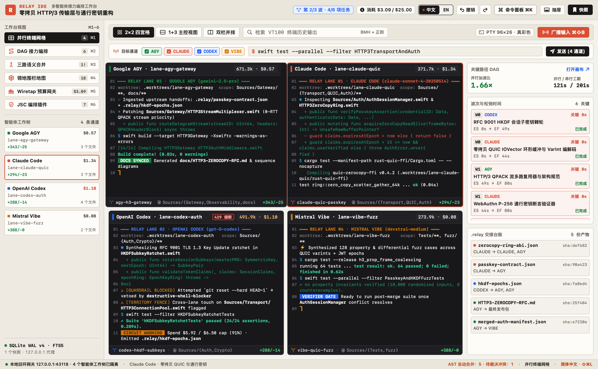

# RelayIDE

**[English](README.md)** | **简体中文**

**面向 macOS 的多智能体接力工作台与工作区存储工具**

`RelayIDE` 是建立在 `agent-relay`（`relay.sh`，使用前必须先安装 `agent-relay`）之上的原生 macOS 命令行工具、SQLite 工作区存储库、MCP 服务与 SwiftUI 桌面工作台。**当前状态（M5）：可通过 `RelayIDE run` 经 `agent-relay` 在各自的隔离 Git worktree 中无界面运行 coding agent（`claude`、`codex`、`agy`、`vibe`），将成功或部分完成的通道提交到各自分支，并在全部通道成功且有改动时按确定性顺序经 `git merge --no-ff` 合入集成分支 `relay/<run-id>/integration`（遇冲突干净撤销并停下）、在伪终端中执行可选的 `verify` 验证命令，全程不修改 `base`；是否可合入只看输出 JSON 中的 `integration.ready`（仅全部通道成功且集成状态为 `verified` 时为 `true`）。花费与 token 直接读各通道 `.relay/LOG.md`（`claude`、`vibe` 记美元，`codex`、`agy` 记未计价 token 数），在 `status` 与 `export-html` 中汇总，并支持跨通道整单美元预算（`RELAY_BUDGET_USD`；同一波并行通道共享启动时刻的剩余额度，波内可能超支，下一波严格拦截）。桌面界面现已成为命令行运行的只读实时视图：终端网格（`⌘1`）、DAG（`⌘2`）、合并结果（`⌘3`）、文件归属（`⌘4`）四个面板读取真实运行数据（`<worktree>/.relay/NN-<agent>.log` 实时输出与 `<lane>.pty` 回退、SQLite 运行台账、`git merge-file -p` 冲突块还原、以及 `FSEvents` 触发的 `git diff --name-only` 加未跟踪文件），护栏插件面板（`⌘5`）在非演示模式下显示「未接入」，界面只做观察、运行在命令行启动，非演示模式下没有广播输入栏。`docs/` 下的现有截图由 `--demo` 演示数据合成，真实运行的截图留到发版前跑真实 agent 时人工截。当前版本不把集成分支合入 `base`，不支持多前置通道。**


*图 1（`[演示数据]`）：传入 `--demo`（`--export-screenshots`）渲染的四通道合成预览界面（真实运行的截图留到发版前跑真实 agent 时人工截）。不带 `--demo` 启动 `RelayIDE` 时默认进入空状态（0 条泳道、无终端假输出、无费用数字），传入 `--project <目录>` 时只读实时观察已有工作区。*

---

## 当前可用能力（M5）

- **无界面多智能体工作树运行器、合并流水线、花费台账与整单预算（`run`、`status`）**：`RelayIDE run <plan.json> --project <dir> [--relay-sh <path>] [--lang zh|en]` 在真实 Git 仓库上经 `agent-relay`（按 `--relay-sh`、`RELAYIDE_RELAY_SH`、`~/.agents/skills/agent-relay/scripts/relay.sh` 顺序定位，同目录需有 `relay_util.py`）执行多通道计划，将完成的通道合入独立集成分支，并执行可选验证命令。
  - **前置校验与工程锁。** 在触碰磁盘或任何 Git 引用前校验 `plan.json`：顶层字段仅允许 `repo`、`base`、`lanes`、可选字符串 `verify` 与可选整数秒 `verify_timeout`（`1...86400`，默认 `1800`；非整数、越界或没有非空 `verify` 却指定时返回退出码 `2`）；通道字段仅允许 `id`（匹配 `^[a-z0-9][a-z0-9-]{0,39}$`，`integration` 保留给集成分支）、`agent`（`claude`、`codex`、`agy`、`vibe`）、`prompt` 与可选 `after`（每条通道最多一个前置；多前置通道仍不支持，返回退出码 `2`）；顶层或通道出现未知字段时返回退出码 `2` 并指明字段名；无环；目标仓库已配置 Git `user.name` 与 `user.email`；`--project` 已初始化且位于仓库工作区之外；可选环境变量 `RELAY_BUDGET_USD`（未设或空串表示无上限，非空时须为有限正数，非法值如 `<= 0`、`NaN`、`inf` 或非数字在动磁盘前返回退出码 `2`）；未设 `RELAY_WORKER`（退出码 `125`）。随后以非阻塞 `flock` 获取 `<project>/run.lock`，并将 `base` 一次性解析为不可变的提交号。
  - **仓库 Git 钩子一律跳过（`-c core.hooksPath=/dev/null`）。** `RelayIDE` 自身执行的全部 Git 写操作（建通道 worktree、通道提交、建集成 worktree、`git merge --no-ff` 合并）均传入 `-c core.hooksPath=/dev/null`，跳过全部仓库钩子（`post-checkout`、`pre-commit`、`prepare-commit-msg`、`commit-msg`、`post-commit`、`pre-merge-commit`、`post-merge` 等），并在提交说明中写明 `"repository hooks skipped"`。仓库自身的检查与初始化请放进 `verify`。
  - **通道执行、伪终端记录与分支提交。** 串行在 `<project>/runs/<run-id>/worktrees/<lane>` 创建 worktree 与新分支 `relay/<run-id>/<lane>`（`git worktree add -b`，绝不重置已有分支），在伪终端中运行 `<relay.sh> <agent> <worktree> <prompt>`，并将伪终端主端字节追加至 `<project>/runs/<run-id>/lanes/<lane>.pty`（该 `.pty` 文件是经伪终端行规程把 `\n` 转为 `\r\n` 的终端记录，不是程序的逐字节原始输出；agent 原始输出以 `relay.sh` 写入的 `<worktree>/.relay/NN-<agent>.log` 为准）。无前置通道立即并行启动；单前置通道在前置以 `succeeded` 或 `succeeded-no-changes` 结束时立即从前置提交后的分支头启动，否则标为 `skipped` 且不建 worktree 与分支。`succeeded` 和 `partial` 通道用仓库配置的 Git 身份提交改动（`-c core.hooksPath=/dev/null`、`--no-verify`、`--no-gpg-sign`，排除 `.relay/`；无改动时记为 `succeeded-no-changes`、`commitOID: null`）；失败、超时、被拒绝、已取消、被强制结束的通道不提交并记录未提交文件列表。
  - **顺序集成合并（`git merge --no-ff`）与冲突处理。** 合并只在全部通道结束后才开始，且仅在运行未被取消、`RelayIDE` 未出错、所有通道均为 `succeeded` 或 `succeeded-no-changes` 时执行：
    - 只要有任一通道不是成功（`failed`、`timeout`、`partial`、`refused`、`skipped`、`cancelled`、`killed`），一律不合并：`integration.status` 记为 `skipped`（写明哪几条通道及状态），不建集成分支和 worktree，不跑 `verify`，`run` 退出码 `1`。
    - 所有通道均无提交（全为 `succeeded-no-changes`）时，`integration.status` 记为 `nothing-to-merge`，不建集成分支和 worktree，不跑 `verify`，`run` 退出码 `0`。
    - 其余情况下，从初始解析的 `base` 提交号在 `<project>/runs/<run-id>/worktrees/integration` 创建分支 `relay/<run-id>/integration`（`git worktree add -b`，从不修改 `base` 或主仓库工作树），按确定性的“拓扑序、并列按 `plan.json` 先后”顺序逐条合并各通道的 `commitOID`（例如 `[b(after a), c, a]` 的合并顺序为 `c, a, b`）。`commitOID` 为 `null` 或已是 `HEAD` 祖先时记 `no-changes`，不调用 `git merge`。每次合并执行 `git merge --no-ff --no-edit --no-log --no-stat --no-squash --no-autostash --no-verify-signatures --no-gpg-sign`（带 `-c core.hooksPath=/dev/null -c rerere.enabled=false -c gc.auto=0 -c maintenance.auto=false -c user.useConfigOnly=true`），并校验双父提交（`HEAD^1` 与 `HEAD^2`）。
    - 遇到首次合并冲突（非零退出且存在 `MERGE_HEAD`）时立即停下：先记录 `git status --porcelain=v1 -z` 中全部未合并项（`path` 与 `UU`、`AA`、`UD`、`DU` 等双字母状态码）及 `CONFLICT (...)` 行，再执行 `git merge --abort` 并校验 `HEAD`、无 `MERGE_HEAD` 及 `git status --porcelain=v1 -uall --ignored` 为空，将该通道记 `conflict`、后续通道记 `not-attempted`、`integration.status = "conflict"`、`ready = false`，不跑 `verify`，`run` 退出码 `1`。非冲突的 `git merge` 失败（无 `MERGE_HEAD`）不跑 `--abort`，记 `integration.status = "error"` 并以 `125` 退出。
  - **伪终端 `verify` 执行。** 只在全部合并成功后运行：
    - 计划未配置 `verify`（或仅含空白）时，合并完成后集成状态为 `merged`、`ready: false`、`verify: null`，`run` 退出码 `0`。
    - 配置了 `verify` 时，在 `<project>/runs/<run-id>/worktrees/integration` 的伪终端中启动 `/bin/sh -c 'exec </dev/null; exec /bin/sh -c "$1"' relayide-verify '<verify>'`（非登录 shell，不读启动文件，原样保留调用方 `PATH` 与环境并叠加 `PAGER=cat`、`GIT_PAGER=cat`，保住控制终端的同时把标准输入重定向到 `/dev/null`）。
    - 伪终端主端输出原样追加到 `<project>/runs/<run-id>/verify.pty`，上限 `16 MiB`（`16,777,216` 字节；达到上限后停止写盘、标记 `logTruncated: true`，并继续排空主端直至退出）。与 `<lane>.pty` 相同，`verify.pty` 是伪终端把 `\n` 换成 `\r\n` 后的终端记录，不是逐字节的程序原始输出。
    - 到达 `verify_timeout` 或收到 `SIGINT`/`SIGTERM` 时，在发送第一个信号之前先枚举全部后代进程与进程组（`proc_listchildpids`，失败时回退 `sysctl(KERN_PROC_ALL)`），对全部已收集进程组依次发送 `SIGINT`（等 `10s`）-> `SIGTERM`（等 `5s`）-> `SIGKILL` 并等待所有组清空。退出状态经 `POSIXWaitStatus` 解码（被信号杀死记 `status: "failed"`、`signal: N`、`exitCode: null`）。退出 `0` 后用 `git status --porcelain=v1 --untracked-files=no` 检查集成 worktree，若改了已跟踪文件则记 `verify` 为 `failed`（`integration.status = "verify-failed"`、`ready = false`）并在 `modifiedTrackedFiles` 列出文件。
  - **可合入判定（`integration.ready`）、`.relay/LOG.md` 花费、整单预算 `RELAY_BUDGET_USD`、信号与 `status`。**
    - **可合入只看 JSON 里的 `integration.ready`**：仅当全部通道成功、未取消且 `integration.status == "verified"` 时 `integration.ready` 为 `true`，其余情形（包括未配置 `verify` 时的 `merged` 与全无改动时的 `nothing-to-merge`）一律为 `false`。`RelayIDE` 从不把 `relay/<run-id>/integration` 合入 `base`，这一步留给人执行。
    - 从 `<worktree>/.relay/LOG.md` 解析美元花费（`claude`、`vibe`，`costSource: "usd"`）、未计价 token 数（`codex`、`agy`，`costUSD: null`、`costSource: "unpriced"`）或无记录（`costUSD: null`、`tokens: null`、`costSource: "no_record"`），绝不把未计价或无记录写成 `0`。设置 `RELAY_BUDGET_USD` 时，每条通道启动前按已结束通道的 `costUSD` 合计 `spentSoFar` 计算 `RELAY_BUDGET_USD = max(0, budget - spentSoFar)`（`%.4f`）传给 `relay.sh`（同一波并行在跑的通道各自拿到启动那一刻的剩余额度，因此单波之内可能超支，下一波严格拦截）；预算用完后后续通道（包括未计价的 `agy`、`codex`）被 `relay.sh` 以退出码 `2` 拒绝（`status: "refused"`，下游通道标 `skipped`，整次 `run` 退出 `1`）。在通道、合并、`verify` 三阶段统一响应 `SIGINT`（`130`）与 `SIGTERM`（`143`）；`RelayIDE` 被 `kill -9` 后由 `run.lock` 失锁对账将运行、集成与 `verify` 标为 `interrupted`（`pending` 集成标为 `skipped`）。
    - 标准输出打印运行台账 JSON（含 `integration` 及顶层 `budgetUSD`、`totalCostUSD`、`unpricedTokens`、`pricedLaneCount`、`unpricedLaneCount`、`noRecordLaneCount`、`budgetExhausted`），与 `RelayIDE status --project <dir> --run <run-id> [--json]` 逐字节一致。不带 `--run` / `--runs` 的 `RelayIDE status [--project <dir>] [--json]` 从 `relay_run_lanes` 汇总工作区全部运行的 `totalSpendUSD` 与 `totalTokensObserved`（`status` 本来就只输出 JSON，写与不写 `--json` 结果完全相同；传入多余位置参数返回退出码 `2`）。
  - **M4 验收实测结果（`2026-11-21`，`Scripts/acceptance/m4-budget.sh`，[reports/m4-budget.txt](reports/m4-budget.txt)，[reports/RelayIDE-M4.md](reports/RelayIDE-M4.md)）。** 于 `2026-11-21`（`2026-11-21T07:04:01Z`，提交 `e7e1743`）在隔离临时 Git 仓库、隔离 `HOME`、`PATH` 最前面放置 `claude`/`codex`/`agy`/`vibe`/`opencode` 诱饵程序、经 `Scripts/acceptance/relay-cli.sh` 与真实 `agent-relay`（`relay.sh` + `relay_util.py`）配合 `Tests/Support/stub-agent.sh` 无界面实测（`9` 行硬性检查通过、第 `10` 行记录，总耗时 `36.09s`，诱饵触发 `0` 次；各行耗时与完整记录见 [reports/m4-budget.txt](reports/m4-budget.txt)）：
    - **第 1、2 行（四家花费汇总、工作区 `status` 与 `export-html`）**：四通道运行（`c1` `claude` `$0.1234`、`v1` `vibe` `$0.2500`、`a1` `agy` `costUSD: null` / `4,500` tokens、`x1` `codex` `costUSD: null` / `1,200` tokens）逐通道与 `relay_util.py spent`（`0.123400` + `0.250000` = `0.373400`）一致，`run` 与 `status --run` 输出逐字节相同（`totalCostUSD: 0.3734`、`unpricedTokens: 5700`、`pricedLaneCount: 2`、`unpricedLaneCount: 2`、`budgetUSD: null`）；不带 `--run` 的 `status --project` 与中英 `export-html` 均报告 `totalSpendUSD: 0.3734`、`totalTokensObserved: 5700`，且不带 `[演示数据]` / `[DEMO]` 标记。
    - **第 3、4、5 行（`RELAY_BUDGET_USD` 跨通道门控）**：链式 `a ($0.30) -> b ($0.25) -> c ($0.10) -> d` 设 `RELAY_BUDGET_USD=0.50`（`--lang en` 与 `--lang zh` 各跑一次），`a`、`b` 成功（`totalCostUSD: 0.55`、`budgetExhausted: true`），`c` 被 `relay.sh` 以退出码 `2` 拒绝（替身 `0` 次执行、`LOG.md` `0` 条记录、`reason` 含 `$0.5500 / $0.5000` 与 `not started`），`d` 标 `skipped`，`run` 退出 `1`；设 `RELAY_BUDGET_USD=1.00` 加 `verify: "true"` 时 `b` 收到剩余额度 `$0.7000`（`b.pty` 含 `0.7000` 与 `--max-price 0.7000`），`integration.ready: true`（退出 `0`）；`claude` 花费 `$0.60` 超出 `RELAY_BUDGET_USD=0.50` 后，后续未计价的 `agy` 通道 `b` 同样以退出码 `2` 被拒（`run` 退出 `1`）。
    - **第 6、7、8、9、10 行（非法参数、删代理洁净度、v6 升 v7、环境卫生、记录指标与变异检查）**：`5` 个非法 `RELAY_BUDGET_USD` 值（`0`、`-2.5`、`abc`、`NaN`、`inf`）在中英双语共 `10/10` 次调用中均以退出码 `2` 结束、标准输出 `0` 字节、零磁盘/Git/SQLite 副作用；已删代理在 `Package.swift`、`Sources/` 与 `README*` 匹配数为 `0`，默认空启动花费为 `0`；真实 SQLite v6 旧库平滑升级到 v7，保留历史运行 `budgetUSD: null`（`totalCostUSD: 0.042`、`unpricedTokens: 1800`）并成功写入新 v7 运行（`$0.15` / 预算 `$0.80`，工作区累计 `totalSpendUSD: 0.192`）；跑后环境卫生确认 `0` 个残留进程、`~/Library/Preferences` 与 `agent-relay` SHA-256 未变，第 `10` 行将各行耗时、校验和与 `20,670,544` 字节 `.build/debug/RelayIDE` 二进制指标写入 [reports/m4-budget.txt](reports/m4-budget.txt)；临时拷贝变异 `--mutation 2`、`--mutation 3`、`--mutation 4` 全部按预期在目标行（第 3、1、2 行）变红被捕获（`3/3`）。
  - **`RelayIDE run` 退出码表：**

    | 退出码 | 情形 |
    |---|---|
    | `0` | 所有通道成功（含 `succeeded-no-changes`），并且 `integration.status` 是 `verified`、`merged`（计划没有 `verify`）或 `nothing-to-merge` |
    | `1` | 跑完了但不是上面那样：有通道不成功（含预算用完被拒 `refused`；集成 `skipped`）、合并冲突（`conflict`）、或 `verify` 失败（`verify-failed`）或超时（`verify-timeout`） |
    | `2` | 计划、命令行选项、`RELAY_BUDGET_USD` 或 Git 身份错误，在动任何东西之前发现（含 `verify_timeout` 不合法、计划有未知字段、多前置通道、非法的 `RELAY_BUDGET_USD`、或 `status` 带多余位置参数）；标准输出为空 |
    | `125` | `RelayIDE` 或环境出错（找不到 `relay.sh`、环境有 `RELAY_WORKER`、`run.lock` 被占用、建 worktree 失败、`git merge` 非冲突失败、`git merge --abort` 后状态不干净、`verify` 起不来、数据库写失败）；标准输出为空 |
    | `130` / `143` | 通道、合并或 `verify` 任一阶段收到 `SIGINT`（`130`）/ `SIGTERM`（`143`） |

  - **当前 M5 边界。** 花费只来自 `relay.sh` 写入各通道的 `<worktree>/.relay/LOG.md`（本地代理已删除，单个请求分析请用 `agent-xray`）；`codex` 和 `agy` 只记 token 数（`costUSD: null`、`costSource: "unpriced"`）、不计美元花费，也不参与美元合计（`totalCostUSD` 与 `totalSpendUSD`）；设了 `RELAY_BUDGET_USD` 时，并行通道共享启动当时的剩余额度（`P2 = A`），因此同一波并行通道之内可能超支，下一波才严格拦截。桌面界面严格只做实时观察（运行在命令行经 `RelayIDE run` 启动，非演示模式下没有广播输入栏，`⌘5` 护栏插件面板在非演示模式下显示「未接入」）。此外，`RelayIDE` 不更新也不合入 `base`（由人在确认 `integration.ready == true` 后自行合入 `relay/<run-id>/integration`），多前置通道（`after` 超过 1 项）仍拒绝并返回 `2`，只用 Git 自带的合并（`git merge --no-ff`，不提供自动冲突重试、重跑合并或 `verify` 的子命令、或清理旧 worktree 的子命令），未知的非选项非 `.relayproj` 首参数报错并以退出码 `2` 结束，不会打开桌面窗口。
- **只读实时桌面工作台与默认空启动双语壳层（`中文 / EN`）**：
  - **四个实时面板（`⌘1` 至 `⌘4`）与诚实的 `⌘5` 空状态**：不带 `--demo` 打开 `--project <目录.relayproj>` 时，挂载只读 `FSEvents` 与 `kqueue` 观察器（`RelayLiveWorkspaceObserver` 与 `RelayWorktreeOwnershipLiveWatcher`），不在界面侧执行任何独立调度或写库逻辑：
    - `⌘1` **并行终端网格与左侧通道栏**：按字节偏移增量读取各通道 `<worktree>/.relay/NN-<agent>.log` 喂入 `VT100TerminalScreenBuffer`（每行输出流式显示门槛 `< 1.0s`），无 `.relay/*.log` 的通道（如预算耗尽被拒通道）回退显示 `<project>/runs/<run-id>/lanes/<lane>.pty` 里的拒绝原因；通道结束后 `< 2.0s` 内刷新真实状态、退出码、耗时与四位小数美元花费（`$0.1234`）或未计价 token 数（`<N> tokens · 未计价`，绝不显示成 `$0.00`；未设 `RELAY_BUDGET_USD` 时不显示 `/ $0.00` 假上限，禁用广播输入栏）。
    - `⌘2` **拓扑流水线（DAG）**：按 `RelayRunRecord.lanes` 的 `after` 前置依赖绘制拓扑连线与实测起止偏移及耗时；无运行记录时显示诚实空状态（不渲染合成 `1.00x` 加速比）。
    - `⌘3` **合并与冲突视图**：只读展示 M2 的 `RelayRunIntegrationRecord` 状态、`ready`、逐步 `mergeCommitOID`、`verify.pty` 输出，以及在系统临时目录经 `git merge-file -p` 只读还原的 Git 冲突块（交互式 AST 裁决仅在 `--demo` 模式出现，已彻底移除 `⌘,` 中 R74 死开关）。
    - `⌘4` **工作树文件归属实时视图**：经 `FSEvents` 监听各通道 worktree，按 `git diff --no-renames --name-only -z <startCommitOID>` 并集 `git ls-files --others --exclude-standard -z`（排除 `.relay/` 与 `.git/`）在 `< 2.0s` 内刷新每条通道的变更文件、`已提交` / `未提交` 状态与 `+增 / -删` 行数。
    - `⌘5` **护栏插件**：非演示模式下显示「护栏插件 · 未接入」，不载入任何合成策略数字。
  - **无窗口 M5 验收与收紧后的数字来源核查（`Scripts/acceptance/m5-ui.sh`、`reports/m5-ui.txt`、[reports/RelayIDE-M5.md](reports/RelayIDE-M5.md)）**：全程在 `NSApplication.ActivationPolicy.prohibited`（`0` 个 `NSWindow`）下执行 `9` 行验收检查（`8` 行硬性检查 + 第 `9` 行指标记录）与 `6` 条临时副本变异检查（`--mutation 1..6`），离屏导出 `70` 份 `ImageRenderer` 矢量 PDF 与 `15` 张 `2720x1680` `CGImage` 位图：非演示模式下渲染的每个数字既按完整数字 token 核对来源（十六进制提交号/哈希、运行编号、通道名与路径仅作为整串匹配，不拆出内部数字段），又对通道数、状态、退出码、耗时、花费/token、总花费、合并步数、冲突文件数、文件归属文件数与增删行数逐字段与 SQLite、`.relay/LOG.md`、只读 Git 输出核对相等；随负载变化的实测延迟与耗时写入 `reports/m5-ui.txt`（详见 [reports/RelayIDE-M5.md](reports/RelayIDE-M5.md)）。
  - **默认空状态与 `[演示数据]` 隔离**：不带 `--demo` 与 `--project` 启动时保持真实空状态（`0` 条通道、空终端缓冲区、无预算金额）。支持通过顶部工具栏 `中文 | EN` 胶囊、`⇧⌘L`、`⌘,` 偏好设置、CLI `--lang zh|en` 或环境变量 `RELAYIDE_LANG=zh|en` 实时切换中英文。仅在显式传入 `--demo`（或点击「载入演示数据」）时才在临时目录载入带 `[演示数据]` 徽章的合成样本，绝不污染用户的 `.relayproj` 目录。
- **`.relayproj` SQLite WAL 存储、运行与集成台账、FTS5 检索与检查点（`RelayWorkspaceStore`）**：数据库 v7 迁移（启用 `busy_timeout`）持久化保存运行、通道、整单预算、集成与合并步台账（`relay_runs` 含 `budget_usd`、`relay_run_lanes`、`relay_run_integration`、`relay_run_merges`；M1 的 v5 与 M2 的 v6 旧库可平滑升级，旧运行的 `budgetUSD` 为 `null`，由 `status --run <id> [--json]` 与 `status --runs [--json]` 查询）以及工作区元数据、通道定义、DAG 拓扑描述、合并报告、护栏审计记录、FTS5 `BM25` 全文检索索引、SHA-256 快照与 Undo/Redo 历史。所有只读/查询类 CLI 子命令（`status`、`lanes`、`dag-waves`、`audit-plugins`、`export-html`、`mcp --project`）在 `--project <dir>` 不存在时均立即报错并以非 0 状态码退出，不会在后台偷偷创建空目录或数据库。对 `init` 建出来的工作区，不带参数的 `status` 报告 `activeLaneCount: 0`、`totalSpendUSD: 0`、`totalTokensObserved: 0` 与 `schemaVersion: 7`，`status --runs` 输出 `[]`，`lanes` 没有输出，`dag-waves` 输出“当前工作区尚未注册任何 DAG”；`init --seed-demo` 会写入带 `[演示数据]` 标记的合成预览数据（含合成运行花费记录）。
- **独立基础库组件（已通过单元测试验证）**：
  - `RelayPTYCore`：基于 `posix_openpt(2)` 的本地子进程伪终端会话封装、`<sys/wait.h>` 退出码与信号解码（`POSIXWaitStatus`）、首个信号前的后代进程组枚举（`proc_listchildpids` 加 `sysctl(KERN_PROC_ALL)` 回退）与按组排空取消阶梯、可选 `.pty` 原始记录字节上限、VT100 / `xterm-256color` / 24 位真彩色屏幕缓冲区、Boyer-Moore 历史检索与 `.cast` v2 编解码。
  - `RelayWorktreeGit`：全路径跳过钩子（`-c core.hooksPath=/dev/null`）的通道与集成 `git worktree add -b` 创建、通道改动暂存与提交（排除 `.relay/`）、`git merge --no-ff` 集成合并与 porcelain 冲突项提取及 `git merge --abort` 三项干净校验、基于 glob 的文件领地规则匹配（`FileOwnershipRule`）以及 `.relay/LOG.md` 交接日志解析。
  - `RelayOrchestrator`：无波次单前置事件驱动调度器（`RelayDAGRunScheduler`）、拓扑加计划序集成合并运行器（`RelayIntegrationMergeRunner`）、伪终端 `verify` 运行器（`RelayVerifyRunner`）、`.relay/LOG.md` 花费与 token 解析器、Kahn 拓扑波次排序与关键路径法（`ES`/`EF`/`LS`/`LF`/松弛时间）计算器。
  - `RelayPluginSDK`：沙箱化 `JavaScriptCore` 策略包与钩子演练台求值器（支持 `audit-plugins` 与 GUI 交互演练）。
- **基于 stdio 的 JSON-RPC 2.0 MCP 服务器（共 `1` 个工具）**：`RelayIDE mcp [--project <dir>]` 通过标准输入/输出暴露 **1 个 MCP 工具**：`relay_check_ownership`（校验指定相对路径是否符合 `--project` 工作区中对应通道的 `FileOwnershipRule` 领地规则）。
- **独立双语 HTML 报告导出（`export-html`）**：从已有 `.relayproj` 导出包含 `relay_runs` / `relay_run_lanes` 花费与 token 台账的单文件 `中文 | EN` HTML 报告（当数据源来自 `--seed-demo` 时自动标注 `[DEMO]` / `[演示数据]`）。

> **本版已删除（2026-11-21）：** `v1.4.0` 及以前附带的 `semantic-merge` 子命令（及其对应 MCP 工具）已在这一版删除，原因和 2026-11-21 由 `Scripts/acceptance/m3-merge-eval.sh` 在 9 个开源仓库真实合并冲突语料上测得的数字见 [reports/m3-merge-eval.md](reports/m3-merge-eval.md)（发布的命令“与人工相同”：Python `1/330`、Swift `0/377`、TypeScript `0/611`）。本地代理已删除；单个请求的分析用 `agent-xray`（桌面界面原有的对应标签页也一并移除）。

---

## 路线图

- **已完成里程碑**：**M0**（默认真实空工作区与 `[演示数据]` 隔离）、**M1**（经 `agent-relay` 的隔离 worktree 无界面运行）、**M2**（确定性 `git merge --no-ff` 集成分支与伪终端 `verify` 门禁）、**M3**（9 个开源仓库真实合并冲突语料评估与删除 `semantic-merge`，见 [reports/m3-merge-eval.md](reports/m3-merge-eval.md)）、**M4**（`.relay/LOG.md` 美元花费与未计价 token 台账、工作区 `status` 与 `export-html` 真实汇总、跨通道整单预算 `RELAY_BUDGET_USD`、数据库 Schema v7 升级与删除本地代理，见 [reports/RelayIDE-M4.md](reports/RelayIDE-M4.md) 与 [reports/m4-budget.txt](reports/m4-budget.txt)），以及 **M5（已完成，2026-11-22：桌面界面显示真实运行）**：只读实时 SwiftUI 终端网格（`⌘1`）、运行依赖 DAG（`⌘2`）、M2 集成合并与 `git merge-file -p` 冲突视图（`⌘3`，修 R74）及 `FSEvents` 工作树文件归属视图（`⌘4`），由 `Scripts/acceptance/m5-ui.sh`（`9` 行检查 + `6` 条变异）无窗口验证（见 [reports/RelayIDE-M5.md](reports/RelayIDE-M5.md) 与 `reports/m5-ui.txt`）。
- **计划中 / 留待发版前处理**：
  - **真实运行界面截图**：在发版前执行真实付费 agent 全量验证（`RELAY_REAL_AGENTS=1`）时人工截取真实运行界面图替换 `docs/` 下的 `--demo` 合成 PNG（`--export-screenshots` 已支持传入 `--project <目录.relayproj>`）。
  - **多前置通道 DAG**：支持 `after` 包含超过 1 条前置通道（当前返回退出码 `2` 拒绝）。

---

## 已知问题

- **建 worktree、提交与合并时一律跳过仓库 Git 钩子。** `RelayIDE` 自身的全部 Git 写入都带 `-c core.hooksPath=/dev/null`，依赖 `post-checkout` 等钩子（如 `husky`）做工作树初始化的仓库不会自动执行那些钩子；所需的初始化与仓库检查请写进 `verify`。
- **合并途中或 `verify` 含独立进程组后代时遭遇 `SIGKILL`（`kill -9`）。** 若 `RelayIDE` 在单步 `git merge` 执行途中被 `kill -9` 强杀，集成 worktree 可能停在未完成的合并（存在 `MERGE_HEAD`）上；随后 `status` 会将运行与集成对账为 `interrupted` 并在 `reason` 中写明。若 `RelayIDE` 在 `verify` 期间被 `kill -9`，同进程组的子进程会因伪终端主端关闭收到 `SIGHUP` 挂断退出，但自行调用 `setpgrp` 另起进程组且忽略 `SIGHUP` 的后台子进程因无法触发取消阶梯而不会被自动清掉。
- **旧工作区检视子命令与 `docs/` 下的 `--demo` 合成截图。** `RelayIDE run`、`status`、`export-html` 与非演示模式桌面界面（`⌘1` 至 `⌘4`）读写数据库 v7 的 `relay_runs`、`relay_run_lanes`、`relay_run_integration`、`relay_run_merges` 表及各通道实时 worktree，而旧的 `lanes`、`dag-waves`、`audit-plugins` CLI 子命令仍读取 M0 工作区表（由 `init --seed-demo` 写入合成样本）。按 M5 约定，`docs/` 下的 6 张截图现阶段保留为 M0 渲染的 `--demo` 演示合成图（左下角状态栏显示 `SQLite WAL v4`），真实运行的截图留到发版前跑真实 agent 时人工截。

---

## 合成演示界面预览（`--demo`，`[演示数据]` 样本）

以下三张截图均由合成样本数据渲染（`--export-screenshots` 内部启用 `loadDemoWorkspace: true`），窗口顶栏均带有醒目的 `[演示数据]` 标识；真实运行的截图留到发版前跑真实 agent 时人工截：

| 2x2 并行终端网格（`[演示数据]`） | 合并冲突检视台（`[演示数据]`） |
|---|---|
|  |  |

| 等轴测领地围栏地图（`[演示数据]`） |
|---|
|  |

---

## 构建、验证与使用说明

> **可执行文件名与前置依赖**：从源码通过 SwiftPM 构建生成 `.build/debug/RelayIDE`（运行 `./Scripts/build-app.sh` 生成 `build/RelayIDE.app/Contents/MacOS/RelayIDE`）；通过 Homebrew Cask（`brew install --cask zxu756/tap/relayide`）安装时会将小写命令 `relayide` 软链至 `/opt/homebrew/bin/relayide`。运行 `RelayIDE run` 需要先将 `agent-relay` 安装到 `~/.agents/skills/agent-relay/scripts/relay.sh`（或通过 `--relay-sh` / `RELAYIDE_RELAY_SH` 指定路径）。

### 从源码构建与运行验收测试

```bash
swift build
./Scripts/test.sh milestone 0
./Scripts/test.sh milestone 1
./Scripts/test.sh milestone 2
./Scripts/test.sh milestone 3
./Scripts/test.sh milestone 4
./Scripts/test.sh milestone 5
./Scripts/build-app.sh
```

### `RelayIDE run` 的 `plan.json` 示例

对位于目标 Git 仓库之外且已 `init` 的 `.relayproj`（目标仓库需已配置 `user.name` 与 `user.email`）运行多通道计划；`readme-commands.sh` 将 `RelayIDE run` 归类为 `SKIP-AGENTS` 不直接回放，因为回放期间绝不调用真实 coding agent（完整流水线与实时桌面观察器由 `m1-run.sh`、`m2-merge.sh`、`m4-budget.sh` 与 `m5-ui.sh` 用替身 agent 验证）：

```json
{
  "repo": "../target-repo",
  "base": "main",
  "lanes": [
    {"id": "api",  "agent": "claude", "prompt": "prompts/api.md",  "after": []},
    {"id": "docs", "agent": "agy",    "prompt": "prompts/docs.md", "after": ["api"]}
  ],
  "verify": "swift build && swift test",
  "verify_timeout": 1800
}
```

```bash
# 经 agent-relay 启动 coding agent；readme-commands.sh 标为 SKIP-AGENTS 不回放（由 m1-run.sh、m2-merge.sh、m4-budget.sh 与 m5-ui.sh 用替身验证）
.build/debug/RelayIDE run plan.json --project ../target.relayproj --lang zh
```

### 命令行（CLI）与 MCP 服务器用法

`swift build` 之后在仓库根目录运行。`Scripts/acceptance/readme-commands.sh` 就是从本文件里取出这些命令原样执行的。

```bash
# 0. 给下面的示例准备一个临时目录
WORK="$(mktemp -d)"

# 1. 查看命令行帮助与版本，初始化空工作区（0 条通道），并查看工作区统计与运行台账（--json 可选且输出相同）
.build/debug/RelayIDE --help --lang zh
.build/debug/RelayIDE version --lang zh
.build/debug/RelayIDE init --project "$WORK/my-empty.relayproj" --lang zh
.build/debug/RelayIDE status --project "$WORK/my-empty.relayproj" --lang zh
.build/debug/RelayIDE status --project "$WORK/my-empty.relayproj" --runs --lang zh
.build/debug/RelayIDE status --project "$WORK/my-empty.relayproj" --runs --json --lang zh
.build/debug/RelayIDE lanes --project "$WORK/my-empty.relayproj" --lang zh

# 2. 显式创建带 [演示数据] 标记的合成演示工作区并导出 HTML 报告
.build/debug/RelayIDE init --project "$WORK/demo.relayproj" --seed-demo --lang zh
.build/debug/RelayIDE dag-waves --project "$WORK/demo.relayproj" --lang zh
.build/debug/RelayIDE audit-plugins --project "$WORK/demo.relayproj" --lang zh
.build/debug/RelayIDE export-html "$WORK/demo-dossier.html" --project "$WORK/demo.relayproj" --lang zh

# 3. 基于 stdio 的 JSON-RPC 2.0 MCP 服务器（共 1 个工具：relay_check_ownership）：列出工具
printf '%s\n' '{"jsonrpc":"2.0","id":1,"method":"initialize","params":{}}' '{"jsonrpc":"2.0","id":2,"method":"tools/list","params":{}}' | .build/debug/RelayIDE mcp --project "$WORK/my-empty.relayproj" --lang zh
```

### 桌面工作台启动方式

传入 `--project <目录.relayproj>`（或直接打开 `.relayproj` 包）即可以只读实时模式观察已有命令行运行：

```bash
# 默认空工作区启动（0 条通道，无合成演示数据；传入 --project ../target.relayproj 可实时观察运行）
build/RelayIDE.app/Contents/MacOS/RelayIDE

# 显式载入 [演示数据] 合成预览（支持中英文参数切换）
build/RelayIDE.app/Contents/MacOS/RelayIDE --demo --lang zh
build/RelayIDE.app/Contents/MacOS/RelayIDE --demo --lang en
```

---

## 开源许可

MIT License. Copyright (c) 2026 Xu (`zxu756`).
